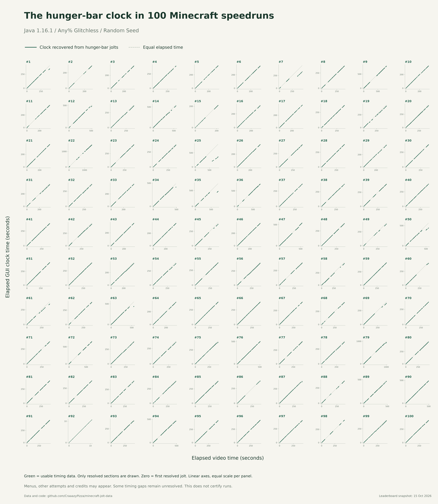

# Minecraft jolt data

Hunger-bar timing measurements for the top 100 Minecraft Java 1.16.1 Any% Glitchless random-seed runs, frozen on 15 October 2026.

All 100 have usable jolt data. No cheating established. Some timing differences remain unresolved, and supported sections cannot certify a whole run.



[Individual plots](plots/) | [Run and video index](data/index.json) | [Vector overview](plots/overview.svg)

Each plot uses one proof recording. The x-axis shows elapsed video time and the y-axis shows elapsed GUI time. Both are linear, in seconds, with the same scale. Zero is the first resolved jolt. The dashed line is equal elapsed time. Separate segments stay disconnected. Recordings can include menus, credits or other attempts.

The data retains observed patterns, food values, candidate GUI ticks, resolved assignments, video links and hashes. GUI time is separate from in-game run time. Ambiguous assignments are excluded from plots.

```sh
python3 check.py
uv sync --frozen
uv run python plot.py
```

`check.py` verifies file hashes, candidates and assignments using Java Random arithmetic. `plot.py` rebuilds the images. `data/index.json` links each run to its measurement files.

Extraction follows [Tick Studio](https://gitlab.com/fanda8571/tick_studio) and [Dart's Jolt Cracker](https://dartjs.com/joltcracker), with RNG arithmetic checked against the Minecraft 1.16.1 client. AI agents reviewed the flagged clips.
